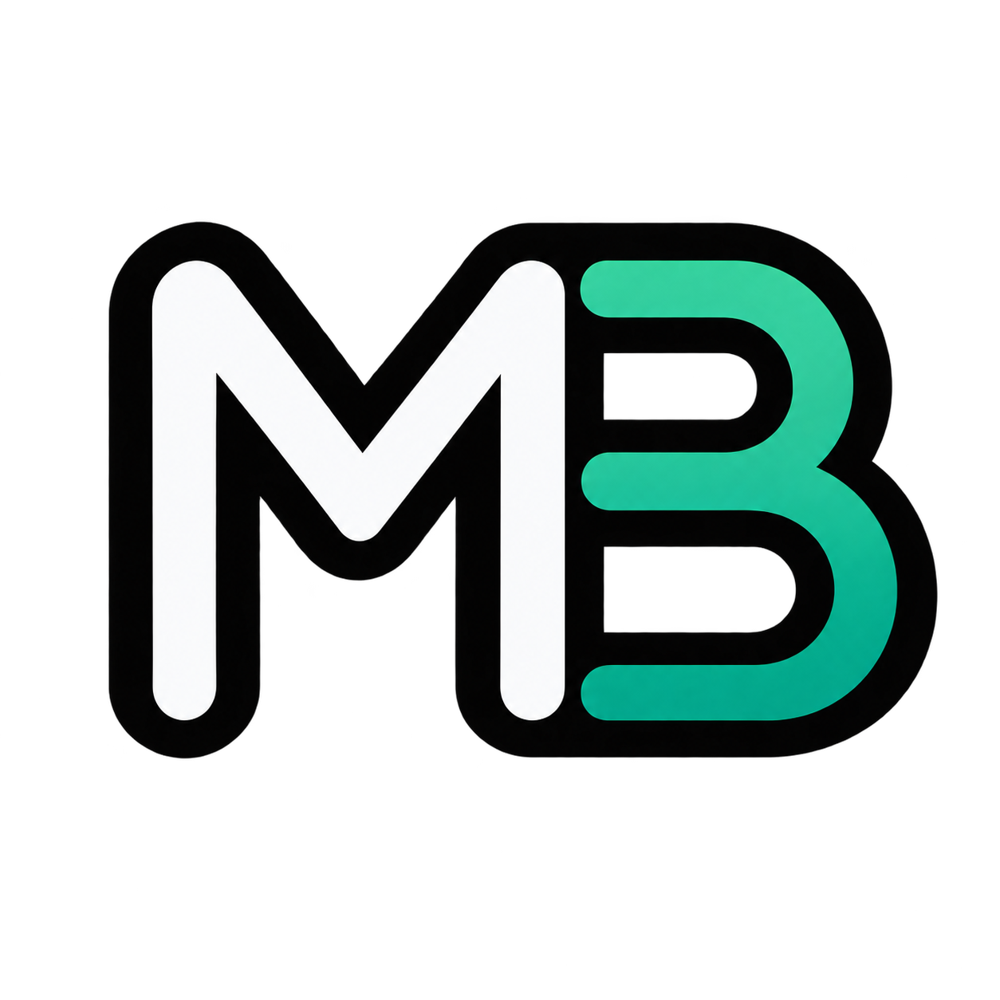

<div align="center">

  

  # Mohamed Badwy — Full-Stack Developer Portfolio

  <p>
    A multilingual, responsive portfolio for presenting projects, skills, experience,
    and contact information in a focused developer-first interface.
  </p>

  <p>
    <a href="https://mohamedbadwy.me">Live website</a>
    ·
    <a href="https://github.com/mohamedBadwy22">GitHub</a>
    ·
    <a href="https://www.linkedin.com/in/mohamed-badwy-96a34322/">LinkedIn</a>
  </p>

  <p>
    
    
    
    
  </p>

</div>

<br />

> **Design direction**
> The interface uses an emerald-led color palette, rounded navigation and cards, subtle motion, generous spacing, and a light/dark theme toggle. The same visual language is carried through the project showcase, skills filters, timeline, and contact experience.

## ✦ What is included

| Area | Details |
| --- | --- |
| **Portfolio home** | Introductory hero section, profile image, CV download, and social links |
| **About** | Skills grouped by frontend, backend, and tools, plus a personal journey timeline |
| **Projects** | Localized project cards, category filters, screenshots, and individual project detail pages |
| **Contact** | Validated contact form with toast feedback and email delivery through Resend |
| **Internationalization** | English, German, and Arabic translations with automatic RTL layout for Arabic |
| **Theme** | Light and dark modes powered by `next-themes` |
| **Responsive UI** | Mobile navigation and layouts that adapt from small screens to large displays |
| **SEO** | Localized metadata, canonical URLs, language alternates, and a site favicon |

## 🧭 Pages

The locale prefix is required for every page:

| Page | English route | Purpose |
| --- | --- | --- |
| Home | `/en` | Introduction and primary calls to action |
| About | `/en/about` | Skills and development journey |
| Projects | `/en/projects` | Filterable project catalogue |
| Project details | `/en/projects/[project-name]` | Detailed project presentation |
| Contact | `/en/contact` | Contact details and message form |

Replace `en` with `de` or `ar` to view the German and Arabic versions. English is the default locale.

## 🛠️ Built with

- **Next.js App Router** — server-rendered pages, metadata, routing, and API routes
- **React 19** and **TypeScript** — component-driven, type-safe UI
- **Tailwind CSS 4** — responsive styling and theme tokens
- **next-intl** — localized routes and translated content
- **next-themes** — light/dark mode persistence
- **React Hook Form + Zod** — contact form state and validation
- **Resend + React Email** — transactional contact emails
- **Radix UI and shadcn/ui** — accessible UI primitives
- **React Icons** — interface and social icons

## 🚀 Getting started

### Prerequisites

- Node.js 20 or newer
- npm
- A Resend API key if you want the contact form to send email

### Install and run

```bash
git clone https://github.com/mohamedBadwy22/portoflio-v1.git
cd portoflio-v1
npm install
npm run dev
```

Open [http://localhost:3000](http://localhost:3000). The application will redirect or resolve pages through the locale-aware routes, such as [http://localhost:3000/en](http://localhost:3000/en).

## ✉️ Contact form configuration

The contact form posts to `/api/contact` and sends messages with Resend. Create a `.env.local` file in the project root:

```env
RESEND_API_KEY=re_your_api_key_here
```

The API route currently sends mail from `onboarding@contact.mohamedbadwy.me` to the portfolio email recipients configured in `src/app/api/contact/route.ts`. Update that route and verify the sender domain in Resend before deploying your own copy.

## 📜 Available scripts

```bash
npm run dev      # Start the development server
npm run build    # Create a production build
npm run start    # Serve the production build
npm run lint     # Run ESLint
```

## 🗂️ Project structure

```text
src/
├── app/
│   ├── [locale]/              # Localized pages and shared layout
│   ├── _component/            # Portfolio UI components
│   ├── _data/projects.ts      # Project catalogue and localized project lookup
│   └── api/contact/route.ts   # Resend-powered contact endpoint
├── components/                # Reusable UI primitives
├── i18n/                      # Locale routing and navigation helpers
├── lib/                       # Shared utilities
└── types/                     # TypeScript domain types
messages/
├── en.json                    # English copy
├── de.json                    # German copy
└── ar.json                    # Arabic copy
public/
├── profile.png                # Home page profile image
├── mohamed_badwy_cv.pdf       # Downloadable CV
└── ...                        # Project images, logo, and social assets
```

## 🎨 Customization guide

1. **Update personal copy** in `messages/en.json`, `messages/de.json`, and `messages/ar.json`.
2. **Add or edit projects** in `src/app/_data/projects.ts`, then add the related images under `public/`.
3. **Update skills** in `src/app/_component/MySkills/MySkills.tsx`.
4. **Replace profile assets** in `public/profile.png`, `public/logo.png`, and `public/mohamed_badwy_cv.pdf`.
5. **Adjust colors and theme tokens** in `src/app/[locale]/globals.css`.
6. **Update social links and contact details** in the home and contact page components.

When adding a locale, update the locale list in `src/i18n/routing.ts`, add its translation file under `messages/`, and include its localized metadata in the relevant pages.

## ☁️ Deployment

The project is ready to deploy on [Vercel](https://vercel.com/). Add `RESEND_API_KEY` to the deployment environment variables, then build and deploy:

```bash
npm run build
npm run start
```

Before going live, confirm that:

- The Resend sender domain is verified.
- The production environment contains `RESEND_API_KEY`.
- The canonical domain in the metadata points to your deployed website.
- The social links, contact recipients, CV, and project content belong to you.

## 📄 License

No license has been declared for this repository. If you plan to reuse or distribute the code, add a license that matches your intended usage.

<div align="center">

  <br />
  <sub>Designed and built by <a href="https://mohamedbadwy.me">Mohamed Badwy</a> with Next.js and TypeScript.</sub>

</div>
